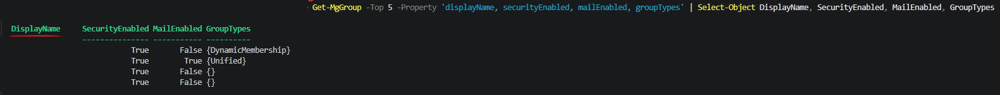
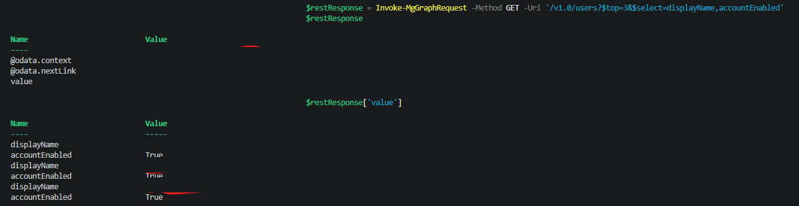
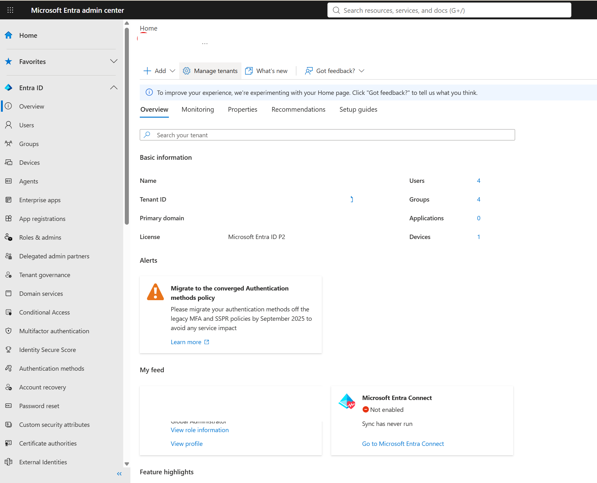

# Lesson 01 — Microsoft Entra ID, Graph and PowerShell Foundations
**Learning track:** SC-300 Identity Engineering Mastery
**Environment:** Personal Entra lab tenant
**Mastery:** Level 3 — Independent
## 1. Business Scenario
An IT administrator needs to retrieve and inspect Microsoft Entra user and group information.
## 2. Identity Architecture
PowerShell 7 → Microsoft Graph PowerShell SDK → Microsoft Graph API → Microsoft Entra ID
1. Business Scenario
An IT administrator needs to retrieve and inspect Microsoft Entra user and group information through an authorized, read-only interface, then verify the results against the Entra admin center.
2. Identity Architecture
PowerShell 7 → Microsoft Graph PowerShell SDK → Microsoft Graph API → Microsoft Entra ID
API results return to PowerShell as objects that can be inspected, selected and stored in variables.
The Entra admin center is used for independent verification. GitHub stores sanitized documentation and scripts, not the live directory data.
3. Key Concepts — In My Own Words
Explain each concept in 1–3 sentences:
•	Entra tenant: It is the organization's identity directory that contains users, groups, applications, and access policies…
•	Azure subscription: Where Azure resources like VMs, storages and networking live and get billed.
•	Tenant ID versus Object ID: Tenant ID identifies the entire Entra directory; while Object ID identifies a specific object inside that directory (user, group, app, service principal)
•	Delegated permission: A low an application to call Microsoft Graph on behalf of a signed-in user.
•	PowerShell object: Contains structured properties and methods instead of plain text output
•	Graph SDK versus REST API: The Graph SDK simplifies Microsoft Graph calls with built-in cmdlets, while REST API gives direct control through HTTP requests. Think: "SDK is the automatic transmission, REST is the manual transmission."
4. Hands-On Exercises and Observations
| Exercise | Expected result | Observed result |
|---|---|---|
| Graph authentication | Delegated connection | Successful |
| User inventory | Up to 3 users | 3 returned |
| Group inventory | Up to 5 groups | 4 returned |
5. Commands and Their Purpose
Explain the purpose of each:
•	Get-MgUser: Retrieves user objects from Microsoft Entra ID through Microsoft Grap.: "Show me users."
•	Get-MgGroup: Retrieves group objects from Microsoft Entra ID: "Show me groups."
•	Invoke-MgGraphRequest: Sends a direct Microsoft Graph API request when a Graph SDK cmdlet doesn't exist or you need full API control: "Raw Graph API access."
•	Get-MgContext: Shows the current Graph connection details such as tenant, account, scopes, and authentication state: "Who am I connected as?"
•	Get-Member: Displays an object's properties and methods so you can discover what data is available: "Inspect the object."
•	Select-Object: Chooses specific properties from an object or creates a cleaner output. Think: "Show only what I need."
6. Authentication and Security
Authentication proves who you are; authorization determines what you're allowed to access. A user can successfully sign in but still be restricted by granted scopes, consent, roles, Conditional Access policies, or resource-specific permissions.
In this learning track, the Delegated Graph permissions observed: User.Read.All, Group.Read.All, openid, profile. This granted read access only and do not include write permissions
What do the scopes permit?
User.Read.All: Read user profiles in the tenant.
Group.Read.All: Read group information and memberships.
Openid: Authenticate the user with OpenID Connect.
Profile: Access basic profile information about the signed-in user.
7. Independent Challenge
Describe how the group inventory command was independently adapted to retrieve DisplayName, SecurityEnabled, MailEnabled and GroupTypes:
I modified Get-MgGroup to return additional properties (DisplayName, SecurityEnabled, MailEnabled, GroupTypes) and used Select-Object to display only those fields.
Explain how the results distinguish a Microsoft 365 group from a regular security group:
A Microsoft 365 group typically shows MailEnabled = True and GroupTypes = {Unified}, while a security group typically shows SecurityEnabled = True with an empty GroupTypes {} value.
8. Validation and Testing
Portal Verification
Verified Graph PowerShell results in the Microsoft Entra Admin Center by opening the corresponding user and group objects. For example, confirmed that the user had AccountEnabled = True, matching the Get-MgUser output.
Expected vs. Actual Results
The values returned by Microsoft Graph matched the properties displayed in the Entra portal, confirming accurate directory data retrieval.
Limitations
Some attributes are not returned by default and require the -Property parameter. Results are also limited by the delegated permissions and Microsoft Graph scopes granted to the session.
Key Takeaway
Microsoft Graph PowerShell provides a reliable way to retrieve Entra ID object data, while the Entra portal serves as a validation source for confirming the returned properties.
9. Problems Encountered and Corrections
Property Selection
Initially displayed too much data. Used Select-Object to return only the required properties.
Correction: Added | Select-Object DisplayName, SecurityEnabled, MailEnabled, GroupTypes.
Lesson: Filter output to focus on relevant information.
Quotation Marks / Syntax
Received an error due to incorrect command syntax while retrieving group properties.
Correction: Reviewed the command and corrected the parameter formatting.
Lesson: Small syntax mistakes can prevent a cmdlet from running successfully.
Indexing
Used $sdkUsers.AccountEnabled, which returned values for all users.
Correction: Changed to $sdkUsers[1].AccountEnabled to target a single user.
Lesson: Arrays are zero-based and must be indexed to access a specific object.
Directory Roles vs. Group Membership
Initially treated directory roles and groups as the same concept.
Correction: Reviewed the object types in Entra ID and compared their purposes.
Lesson: Directory roles grant administrative permissions, while groups manage membership and access.
Key Takeaway
Most issues were caused by syntax, output selection, or misunderstanding object types. Correcting them improved both PowerShell troubleshooting skills and understanding of Microsoft Entra ID concepts.
10. What I Understand Now
During this lab, I became much more comfortable using Microsoft Graph PowerShell to explore Microsoft Entra ID. Seeing the data returned as PowerShell objects helped me understand that I could inspect, filter, and work with directory information instead of just reading text output. I ran into a few mistakes along the way, especially with syntax, property selection, and indexing, but fixing them gave me a better understanding of how PowerShell behaves. I found it useful to verify my results in the Microsoft Entra admin center because it confirmed that the information returned by Graph matched the actual directory objects. One thing that stood out was learning how to distinguish Microsoft 365 groups from security groups by examining their properties. I also gained a clearer understanding of the difference between directory roles and group membership, which had initially seemed similar to me. Overall, working through the challenges myself made the concepts easier to remember and gave me more confidence using Graph PowerShell to query and validate Entra ID data.
11. Remaining Questions
REST API - I want to develop a deeper understanding of Microsoft Graph REST API requests and how they map to Microsoft Graph PowerShell SDK cmdlets.
12. Evidence
Sanitization Note: All screenshots were reviewed and sanitized before publication. Tenant identifiers, domains, usernames, UPNs, object IDs, and other organization-specific information were redacted.
Figure 1. Group inventory retrieved with Get-MgGroup. Group names were redacted to protect tenant-specific information. Properties shown were used to distinguish Microsoft 365 groups, dynamic groups, and security groups:
Figure 2. Microsoft Graph REST query executed with Invoke-MgGraphRequest to retrieve user account status. Usernames and tenant-specific metadata were redacted to protect sensitive information:
Figure 3. Microsoft Entra Admin Center was used to verify tenant, user, and group properties returned by Microsoft Graph PowerShell. All screenshots were sanitized by redacting tenant identifiers, domains, user information, and other sensitive organizational data before publication.

### Figure 1 — Group Inventory

### Figure 2 — Graph REST API Response

### Figure 3 — Entra Admin Center

Mastery assessment: 3/4 — Independent. Operational mastery remains a future goal.